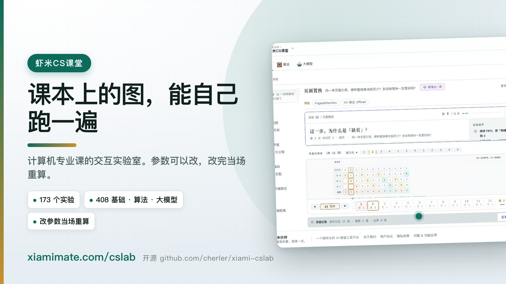

# 虾米 CS 课堂 · 计算机交互实验室

**课本上的图，能自己跑一遍。**

把数据结构、计算机组成、操作系统、网络、算法与大模型的工作过程变成可操作的实验。逐步运行、修改输入、切换策略，再看状态和结果怎样改变。

[开始实验](https://cherler.github.io/xiamimate-cs-lab/) · [视频演示](https://cherler.github.io/xiamimate-cs-lab/promo/) · [开发指南](docs/DEVELOPMENT.md) · [文档导航](docs/README.md)

## 27 秒看一遍：课本上的图，能自己跑一遍

[](https://cherler.github.io/xiamimate-cs-lab/promo/)

[▶ 播放宣传视频](https://cherler.github.io/xiamimate-cs-lab/promo/) · 27 秒 · 1080p · 点击封面播放

视频和封面保留录制时的界面、实验数量与旧地址；当前公开仓库与在线入口以上方链接为准。

## 从“看图”到“动手验证”

| 学习场景 | 可以怎样探索 |
| --- | --- |
| 数据结构与算法 | 逐步观察排序、图算法等过程，修改输入比较轨迹 |
| 计算机组成 | 从 Cache 等实验看状态变化、命中与访问过程 |
| 操作系统 | 比较进程调度、页面置换、磁盘调度等策略 |
| 计算机网络 | 观察 TCP 与滑动窗口等机制的运行过程 |
| 机器学习与大模型 | 浏览相关实验与 Transformer 图解 |
| 学习复盘 | 跟随讲解、查看本步推演、完成练习并保存进度 |

页面按 **408 基础、算法、大模型** 组织入口，并保留算法卡牌与 Transformer 图解。

## 一个实验，四种看法

1. **跑起来**：播放或单步前进，看到每次状态变化。
2. **改一改**：调整参数与输入，重新计算结果。
3. **比一比**：切换规则、扫描参数，观察不同策略的轨迹。
4. **讲清楚**：结合图形、读数、日志和练习解释这一步为什么发生。

仿真内核与独立参考实现分别维护，练习答案从运行轨迹派生。验证过程、覆盖范围与开发记录可在文档中查看。

## 打开就能学

GitHub Pages 提供交互实验、静态讲解、算法卡牌与本地学习进度，不依赖主站账号。学习记录保存在当前浏览器，可在进度面板导出。

浏览器推理原型需要 WebGPU 和可访问的模型下载服务，模型由使用者主动加载。AI 学伴与跨设备同步需要后端，不在 Pages 中提供。

## 本地运行

需要 Node.js 22.12+。

```bash
git clone https://github.com/cherler/xiamimate-cs-lab.git
cd xiamimate-cs-lab
npm ci
npm ci --prefix games/algo-cards
npm run build:pages
npm run preview:pages
```

打开 <http://127.0.0.1:5338/xiamimate-cs-lab/>。引擎开发、实验校验和主站集成方式见 [开发指南](docs/DEVELOPMENT.md)。

## 项目结构

```text
src/core/            文档模型、执行器与验证器
src/kernels/         各领域的仿真内核
src/reference/       独立参考实现
web/                 React 实验视图、讲解与学习进度
web/public/promo/    宣传视频、封面与播放页
games/algo-cards/    算法卡牌
experiments/         Transformer 图解与浏览器推理原型
tests/               内核与内容检查
docs/                蓝图、标准、决策记录与开发指南
```

## 参与改进

欢迎反馈具体实验中的异常状态、讲解不清楚的步骤，或提出想验证的问题。修改实验时请同步核对参考实现、运行轨迹与练习结果，详见 [内容与验收标准](docs/standards.md)。

[虾米伙伴在线版](https://xiamimate.com/cslab/)由个人维护，可能随时暂停或关闭；Pages 的交互实验与本地进度独立运行。

## 虾米伙伴系列

[虾米跨境](https://github.com/cherler/xiamimate-crossborder) · [虾米看 AI](https://github.com/cherler/xiamimate-ai-atlas) · [虾米看股](https://github.com/cherler/xiamimate-stock-lab) · [虾米 CS 课堂](https://github.com/cherler/xiamimate-cs-lab) · [模型工坊](https://github.com/cherler/xiamimate-model-lab)

这些项目由个人持续维护。欢迎通过仓库 Issues 反馈问题、提出具体使用场景；觉得有用，也欢迎 Star 或分享。
